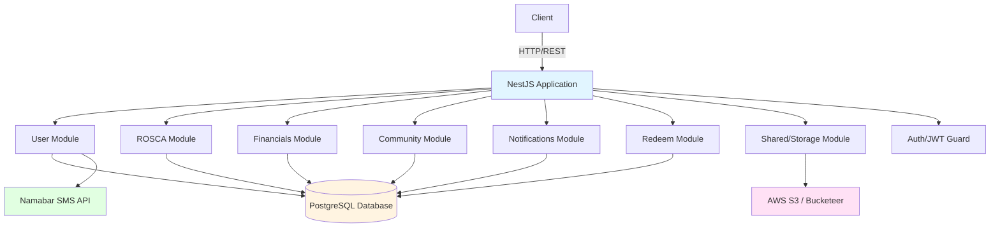
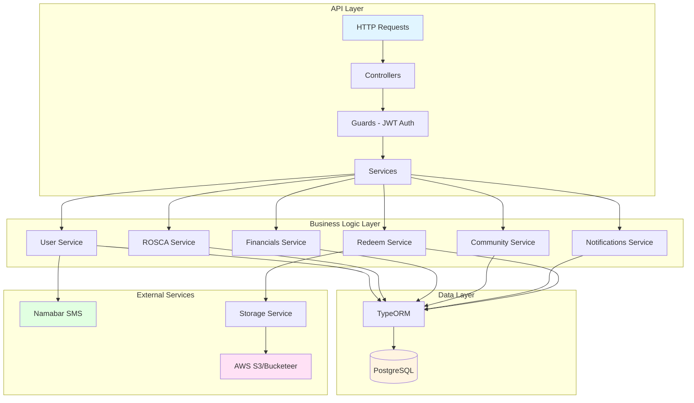

## Risqe Backend (NestJS)

Production-ready NestJS backend implementing User/Auth, ROSCA, Financials, Community, Notifications, and Redeem domains with PostgreSQL + TypeORM.

### Architecture Overview



### System Architecture



### Entity Relationship Diagram (ERD)

```mermaid
erDiagram
    USER ||--o{ GROUP_MEMBER : "has membership"
    USER ||--o{ GROUP_INVITATION : "receives"
    USER ||--o{ GROUP_INVITATION : "sends"
    USER ||--o{ GROUP_TRANSACTION : "makes"
    USER ||--o{ WITHDRAWAL_REQUEST : "requests"
    USER ||--o{ POST : "creates"
    USER ||--o{ COMMENT : "writes"
    USER ||--o{ POST_LIKE : "likes"
    USER ||--o{ NOTIFICATION : "receives"
    USER ||--o{ COLLATERAL_DOCUMENT : "uploads"
    USER ||--o{ USER_COUPON : "redeems"

    ROSCA_GROUP ||--o{ GROUP_MEMBER : "has members"
    ROSCA_GROUP ||--o{ GROUP_INVITATION : "sends"
    ROSCA_GROUP ||--o{ GROUP_TRANSACTION : "records"

    POST ||--o{ COMMENT : "has"
    POST ||--o{ POST_LIKE : "receives"

    COUPON ||--o{ USER_COUPON : "redeemed as"

    USER {
        uuid id PK
        string phoneNumber UK
        string email UK "nullable"
        string firstName
        string lastName
        string passwordHash
        decimal internalBalance "default 0"
        int pointsBalance "default 0"
        int creditScore "default 500"
        boolean isPhoneVerified "default false"
        string phoneOtpCode "nullable"
        timestamp phoneOtpExpiresAt "nullable"
        string namabarVerificationId "nullable"
        string photoUrl "nullable"
        string pendingPhoneNumber "nullable"
        string pendingPhoneOtpCode "nullable"
        timestamp pendingPhoneOtpExpiresAt "nullable"
    }

    ROSCA_GROUP {
        uuid id PK
        uuid adminUserId FK
        string name
        decimal totalFundTarget
        int currentPeriod "default 1"
        string duration "nullable"
        string frequency "nullable"
        string payoutType "ORDERED_LIST | VOTE_BASED"
        boolean isActive "default true"
        json memberOrder "nullable - array of user IDs"
        timestamp createdAt
    }

    GROUP_MEMBER {
        uuid id PK
        uuid groupId FK
        uuid userId FK
        boolean is_admin "default false"
        string status "default ACTIVE"
        decimal totalContribution "default 0"
        decimal totalReceived "default 0"
    }

    GROUP_INVITATION {
        uuid id PK
        uuid groupId FK
        uuid invitedUserId FK
        uuid invitedByUserId FK
        enum status "PENDING | ACCEPTED | REJECTED"
        timestamp createdAt
        timestamp updatedAt
        timestamp respondedAt "nullable"
    }

    GROUP_TRANSACTION {
        uuid id PK
        uuid groupId FK "nullable"
        uuid userId FK
        decimal amount
        string type "CONTRIBUTION | PAYOUT | PENALTY | DEPOSIT | WITHDRAWAL | GROUP_PAYMENT | GROUP_PAYOUT"
        string status "PENDING | COMPLETED | FAILED"
        timestamp createdAt
        timestamp dueDate "nullable"
        string description "nullable"
        string externalTransactionId "nullable"
    }

    WITHDRAWAL_REQUEST {
        uuid id PK
        uuid userId FK
        decimal amount
        string paymentMethod "BANK_TRANSFER | MOBILE_MONEY | CASH"
        string paymentDetails "JSON string"
        string status "PENDING | APPROVED | REJECTED"
        timestamp createdAt
        timestamp processedAt "nullable"
        string externalTransactionId "nullable"
        string failureReason "nullable"
    }

    POST {
        uuid id PK
        uuid userId FK
        string title
        text content
        int likes "default 0"
        int dislikes "default 0"
        timestamp createdAt
        timestamp updatedAt
    }

    COMMENT {
        uuid id PK
        uuid postId FK
        uuid userId FK
        text content
        int likes "default 0"
        int dislikes "default 0"
        timestamp createdAt
        timestamp updatedAt
    }

    POST_LIKE {
        uuid id PK
        uuid postId FK
        uuid userId FK
        timestamp createdAt
    }

    NOTIFICATION {
        uuid id PK
        uuid userId FK
        enum type "PAYMENT_DUE | VOTING_DUE | GROUP_INVITATION | PAYMENT_RECEIVED | VOTE_RESULT"
        string title
        text message
        boolean read "default false"
        uuid groupId "nullable"
        string actionUrl "nullable"
        timestamp createdAt
    }

    COLLATERAL_DOCUMENT {
        uuid id PK
        uuid userId FK
        enum documentType "house | car"
        string documentUrl "nullable"
        enum status "PENDING | APPROVED | REJECTED"
        string rejectionReason "nullable"
        timestamp uploadedAt
        timestamp reviewedAt "nullable"
    }

    COUPON {
        uuid id PK
        string title
        string subtitle "nullable"
        decimal cost "points required"
        string imageUrl "nullable"
        timestamp expiresAt "nullable"
        boolean isActive "default true"
        timestamp createdAt
    }

    USER_COUPON {
        uuid id PK
        uuid userId FK
        uuid couponId FK
        string redemptionCode "nullable"
        timestamp redeemedAt
    }
```



### Module Structure

```
src/
├── app.module.ts                 # Root module
├── main.ts                       # Application entry point
├── config/
│   └── database.config.ts       # Database configuration
├── user/
│   ├── user.entity.ts           # User entity
│   ├── collateral-document.entity.ts
│   ├── user.module.ts
│   ├── auth/                    # Authentication
│   │   ├── auth.controller.ts
│   │   ├── auth.service.ts
│   │   ├── jwt.strategy.ts
│   │   └── guards/
│   └── phone/                   # Phone verification
│       ├── phone.controller.ts
│       └── phone.service.ts
├── rosca/
│   ├── group.entity.ts
│   ├── group-member.entity.ts
│   ├── group-invitation.entity.ts
│   ├── rosca.module.ts
│   └── rosca/
│       ├── rosca.controller.ts
│       └── rosca.service.ts
├── financials/
│   ├── group-transaction.entity.ts
│   ├── withdrawal-request.entity.ts
│   ├── financials.module.ts
│   └── financials/
│       ├── financials.controller.ts
│       └── financials.service.ts
├── community/
│   ├── post.entity.ts
│   ├── comment.entity.ts
│   ├── post-like.entity.ts
│   ├── community.module.ts
│   └── community/
│       ├── community.controller.ts
│       └── community.service.ts
├── notifications/
│   ├── notification.entity.ts
│   ├── notifications.module.ts
│   └── notifications/
│       ├── notifications.controller.ts
│       └── notifications.service.ts
├── redeem/
│   ├── coupon.entity.ts
│   ├── redeem.module.ts
│   └── redeem/
│       ├── redeem.controller.ts
│       └── redeem.service.ts
└── shared/
    └── storage/                 # File storage (S3/Bucketeer)
        ├── storage.module.ts
        └── storage.service.ts
```

### Getting Started

#### 1. Install Dependencies

```bash
npm install
```

#### 2. Database Setup (PostgreSQL)

**macOS:**

```bash
brew install postgresql@15
brew services start postgresql@15
createdb risqe_db
```

**Linux:**

```bash
sudo apt-get install postgresql postgresql-contrib
sudo -u postgres createdb risqe_db
```

#### 3. Environment Configuration

Create a `.env` file in the root directory:

```env
# Database
DB_HOST=localhost
DB_PORT=5432
DB_USERNAME=postgres
DB_PASSWORD=your_password
DB_DATABASE=risqe_db

# JWT
JWT_SECRET=your_jwt_secret_key_here

# SMS Provider (Namabar)
NAMABAR_API_URL=https://api.namabar.krd
NAMABAR_API_KEY=your_api_key
NAMABAR_SENDER_ID=RISQE

# AWS S3 / Bucketeer (for file storage)
BUCKETEER_BUCKET_NAME=your_bucket_name
BUCKETEER_AWS_REGION=eu-west-1
BUCKETEER_AWS_ACCESS_KEY_ID=your_access_key
BUCKETEER_AWS_SECRET_ACCESS_KEY=your_secret_key

# Or use standard AWS credentials
AWS_S3_BUCKET_NAME=your_bucket_name
AWS_S3_REGION=eu-west-1
AWS_ACCESS_KEY_ID=your_access_key
AWS_SECRET_ACCESS_KEY=your_secret_key

# Server
PORT=3000
```

#### 4. Run Development Server

```bash
npm run start:dev
```

The application will be available at:

- **API**: `http://localhost:3000`
- **API Documentation**: `http://localhost:3000/reference` (Scalar)
- **Swagger UI**: `http://localhost:3000/docs` (if configured)

#### 5. Seed Database

```bash
npm run seed
```

#### 6. Run Tests

```bash
# Unit tests
npm run test

# E2E tests
npm run test:e2e

# Test coverage
npm run test:cov
```

### API Documentation

The API documentation is available at `/reference` using Scalar API Reference. All endpoints are documented with:

- Request/response schemas
- Authentication requirements
- Example requests
- Error responses

### Key Features

#### Authentication & User Management

- **Phone-based authentication** with OTP via Namabar SMS
- **JWT-based authentication** for protected routes
- **User profile management** (name, email, photo)
- **Password reset** via OTP
- **Phone number change** with verification
- **Collateral document upload** for credit verification
- **User search** by email, phone, or name

#### ROSCA (Rotating Savings and Credit Association)

- **Group creation** with configurable payout types (ORDERED_LIST, VOTE_BASED)
- **Member management** with admin roles
- **Group invitations** via email
- **Voting system** for payout distribution
- **Transaction tracking** (contributions, payouts)
- **Payment due management** with automatic transaction creation

#### Financial Management

- **Internal wallet** with balance tracking
- **Deposit/Withdrawal** requests
- **Transaction history** with filtering
- **Payment processing** for group contributions
- **Points system** for rewards
- **Credit score** tracking

#### Community Features

- **Posts** with likes/dislikes
- **Comments** on posts
- **Post interactions** tracking

#### Notifications

- **Real-time notifications** for:
  - Payment due reminders
  - Voting deadlines
  - Group invitations
  - Payment received confirmations
  - Vote results
- **Notification filtering** by type
- **Read/unread** status tracking

#### Rewards & Redemption

- **Coupon system** with point-based redemption
- **Coupon management** (active/inactive, expiration)
- **Redemption tracking** with unique codes

#### File Storage

- **S3/Bucketeer integration** for file uploads
- **Avatar uploads** for user profiles
- **Document storage** for collateral verification
- **Automatic URL generation** for uploaded files

### API Endpoints

#### Authentication (`/auth`)

| Method | Endpoint                     | Description                    | Auth Required |
| ------ | ---------------------------- | ------------------------------ | ------------- |
| POST   | `/auth/register`             | Register new user              | No            |
| POST   | `/auth/register/initiate`    | Initiate registration with OTP | No            |
| POST   | `/auth/login`                | Login user                     | No            |
| GET    | `/auth/profile`              | Get user profile               | Yes           |
| PATCH  | `/auth/profile`              | Update user profile            | Yes           |
| POST   | `/auth/forgot-password`      | Request password reset OTP     | No            |
| POST   | `/auth/change-password`      | Change password                | Yes           |
| POST   | `/auth/phone/change/request` | Request phone change OTP       | Yes           |
| POST   | `/auth/phone/change/verify`  | Verify and change phone        | Yes           |
| POST   | `/auth/profile/avatar`       | Upload avatar                  | Yes           |
| POST   | `/auth/collateral/upload`    | Upload collateral document     | Yes           |
| GET    | `/auth/collateral/documents` | Get collateral documents       | Yes           |
| POST   | `/auth/user/check-email`     | Check user by email            | No            |
| POST   | `/auth/user/search`          | Search users                   | Yes           |
| POST   | `/auth/user/check-phone`     | Check user by phone            | Yes           |

#### ROSCA (`/rosca`)

| Method | Endpoint                         | Description              | Auth Required |
| ------ | -------------------------------- | ------------------------ | ------------- |
| POST   | `/rosca/groups`                  | Create ROSCA group       | Yes           |
| POST   | `/rosca/groups/join`             | Join group by code       | Yes           |
| GET    | `/rosca/groups`                  | Get user's groups        | Yes           |
| GET    | `/rosca/groups/:id`              | Get group details        | Yes           |
| GET    | `/rosca/groups/:id/members`      | Get group members        | Yes           |
| GET    | `/rosca/groups/:id/transactions` | Get group transactions   | Yes           |
| POST   | `/rosca/groups/:id/vote`         | Vote on payout           | Yes           |
| POST   | `/rosca/groups/:id/invite`       | Invite member            | Yes           |
| GET    | `/rosca/invitations`             | Get pending invitations  | Yes           |
| POST   | `/rosca/invitations/respond`     | Accept/reject invitation | Yes           |

#### Financials (`/financials`)

| Method | Endpoint                                      | Description               | Auth Required |
| ------ | --------------------------------------------- | ------------------------- | ------------- |
| POST   | `/financials/deposits`                        | Create deposit            | Yes           |
| POST   | `/financials/withdrawals`                     | Create withdrawal request | Yes           |
| GET    | `/financials/withdrawals`                     | Get user withdrawals      | Yes           |
| POST   | `/financials/withdrawals/:id/process`         | Process withdrawal        | Yes           |
| GET    | `/financials/transactions`                    | Get user transactions     | Yes           |
| GET    | `/financials/payments-due`                    | Get payments due          | Yes           |
| POST   | `/financials/transactions/:id/pay`            | Pay transaction           | Yes           |
| POST   | `/financials/groups/:groupId/create-payments` | Create payment dues       | Yes           |

#### Community (`/community`)

| Method | Endpoint                          | Description      | Auth Required |
| ------ | --------------------------------- | ---------------- | ------------- |
| POST   | `/community/posts`                | Create post      | Yes           |
| GET    | `/community/posts`                | Get all posts    | Yes           |
| GET    | `/community/posts/:id`            | Get post details | Yes           |
| PUT    | `/community/posts/:id`            | Update post      | Yes           |
| DELETE | `/community/posts/:id`            | Delete post      | Yes           |
| POST   | `/community/posts/:id/comments`   | Add comment      | Yes           |
| POST   | `/community/posts/:id/like`       | Like post        | Yes           |
| POST   | `/community/posts/:id/dislike`    | Dislike post     | Yes           |
| POST   | `/community/comments/:id/like`    | Like comment     | Yes           |
| POST   | `/community/comments/:id/dislike` | Dislike comment  | Yes           |

#### Notifications (`/notifications`)

| Method | Endpoint         | Description       | Auth Required |
| ------ | ---------------- | ----------------- | ------------- |
| GET    | `/notifications` | Get notifications | Yes           |

#### Redeem (`/redeem`)

| Method | Endpoint              | Description           | Auth Required |
| ------ | --------------------- | --------------------- | ------------- |
| GET    | `/redeem/coupons`     | Get available coupons | Yes           |
| POST   | `/redeem/coupons/:id` | Redeem coupon         | Yes           |

### Example API Requests

#### Register and Login

```bash
# Register new user
curl -X POST http://localhost:3000/auth/register \
  -H "Content-Type: application/json" \
  -d '{
    "phoneNumber": "+9647721270202",
    "firstName": "Ahmed",
    "lastName": "Hassan",
    "password": "securePassword123"
  }'

# Login
TOKEN=$(curl -s -X POST http://localhost:3000/auth/login \
  -H "Content-Type: application/json" \
  -d '{
    "phoneNumber": "+9647721270202",
    "password": "securePassword123"
  }' | jq -r '.access_token')
```

#### ROSCA Group Operations

```bash
# Create group
curl -X POST http://localhost:3000/rosca/groups \
  -H "Authorization: Bearer $TOKEN" \
  -H "Content-Type: application/json" \
  -d '{
    "name": "Peshkawtn",
    "totalFundTarget": 840000,
    "duration": "1 year every month",
    "frequency": "monthly",
    "payoutType": "ORDERED_LIST"
  }'

# Get group details
curl -X GET http://localhost:3000/rosca/groups/{groupId} \
  -H "Authorization: Bearer $TOKEN"
```

#### Financial Operations

```bash
# Create deposit
curl -X POST http://localhost:3000/financials/deposits \
  -H "Authorization: Bearer $TOKEN" \
  -H "Content-Type: application/json" \
  -d '{
    "amount": 50000
  }'

# Create withdrawal request
curl -X POST http://localhost:3000/financials/withdrawals \
  -H "Authorization: Bearer $TOKEN" \
  -H "Content-Type: application/json" \
  -d '{
    "amount": 25000,
    "paymentMethod": "BANK_TRANSFER",
    "paymentDetails": "{\"iban\":\"DE89 3704 0044 0532 0130 00\"}"
  }'
```

#### Community Operations

```bash
# Create post
POST_ID=$(curl -s -X POST http://localhost:3000/community/posts \
  -H "Authorization: Bearer $TOKEN" \
  -H "Content-Type: application/json" \
  -d '{
    "title": "My first post",
    "content": "Hello community!"
  }' | jq -r '.id')

# Add comment
curl -X POST http://localhost:3000/community/posts/$POST_ID/comments \
  -H "Authorization: Bearer $TOKEN" \
  -H "Content-Type: application/json" \
  -d '{
    "content": "Great post!"
  }'
```

### Database Migrations

In development, TypeORM `synchronize` is enabled. For production:

1. Disable `synchronize` in `database.config.ts`
2. Use migrations for schema changes:

```bash
# Generate migration
npm run typeorm migration:generate -- -n MigrationName

# Run migrations
npm run typeorm migration:run

# Revert migration
npm run typeorm migration:revert
```

### Authentication

Most endpoints require JWT authentication. Include the token in the Authorization header:

```
Authorization: Bearer <your_jwt_token>
```

### File Storage Configuration

The application supports both AWS S3 and Bucketeer for file storage. Configure using environment variables:

- **Bucketeer** (recommended for Heroku): Use `BUCKETEER_*` variables
- **AWS S3**: Use `AWS_*` variables

Files are automatically uploaded and public URLs are generated. Supported file types:

- Images: JPEG, PNG, GIF, WebP
- Documents: PDF, DOC, DOCX

### Development Scripts

```bash
# Development
npm run start:dev          # Start with watch mode

# Building
npm run build              # Build for production
npm run start:prod         # Run production build

# Testing
npm run test               # Unit tests
npm run test:watch         # Watch mode
npm run test:cov           # Coverage report
npm run test:e2e           # E2E tests

# Code Quality
npm run lint               # Run ESLint
npm run format             # Format with Prettier

# Database
npm run seed               # Seed database

# Versioning
npm run version:patch      # Bump patch version
npm run version:minor      # Bump minor version
npm run version:major      # Bump major version
```

### Production Deployment

1. **Environment Variables**: Ensure all required environment variables are set
2. **Database**: Run migrations before starting the application
3. **Build**: Run `npm run build` to compile TypeScript
4. **Start**: Use `npm run start:prod` or a process manager like PM2

### Notes

- **TypeORM Synchronize**: Disabled in production. Use migrations instead.
- **JWT Tokens**: Tokens expire after a configured period. Refresh tokens may be implemented.
- **File Uploads**: Maximum file size limits should be configured at the reverse proxy level (e.g., Nginx).
- **Rate Limiting**: Consider implementing rate limiting for production.
- **CORS**: Configure CORS settings for your frontend domain.

### Technology Stack

- **Framework**: NestJS 11.x
- **Language**: TypeScript 5.x
- **Database**: PostgreSQL (via TypeORM)
- **Authentication**: JWT (Passport)
- **File Storage**: AWS S3 / Bucketeer
- **SMS**: Namabar API
- **API Documentation**: Scalar API Reference + Swagger
- **Validation**: class-validator, class-transformer

### Contributing

1. Follow the TypeScript and NestJS coding guidelines
2. Write tests for new features
3. Update API documentation
4. Follow the commit message conventions

### License

This project is private and proprietary.
