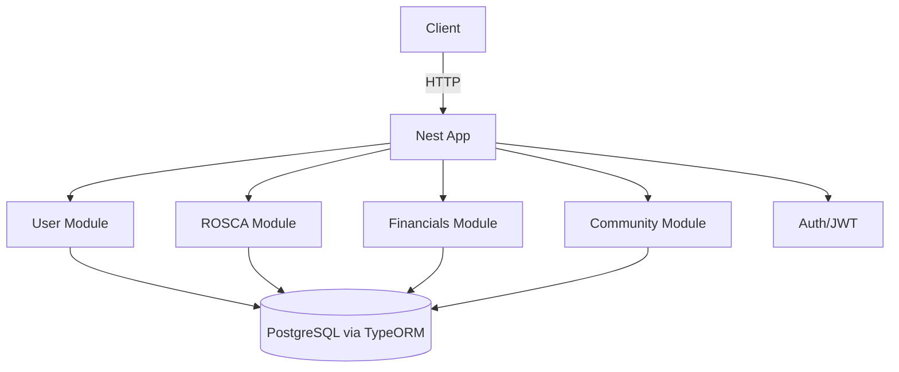
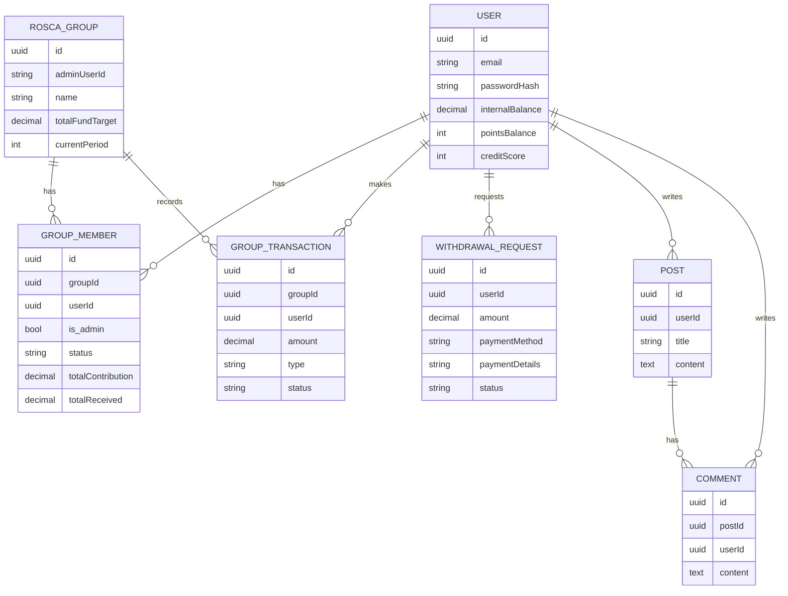

## Risqe Backend (NestJS)

Production-ready NestJS backend implementing User/Auth, ROSCA, Financials, and Community domains with PostgreSQL + TypeORM.

### Architecture (Mermaid)



### Entity Relationships (Mermaid)



### Getting Started

1. Install deps

```bash
npm install
```

2. Run PostgreSQL locally (macOS)

```bash
brew install postgresql@15
brew services start postgresql@15
createdb risqe_db # or /opt/homebrew/opt/postgresql@15/bin/createdb risqe_db
```

3. Configure env

```bash
cp .env.example .env # if you create one, else ensure DB_*, JWT_SECRET are set
```

4. Dev server

```bash
npm run start:dev
# Swagger UI: http://localhost:3000/docs
```

5. Seed data

```bash
npm run seed
```

6. Run tests

```bash
npm run test:e2e
```

### Swagger / OpenAPI

- Serve interactive docs at runtime: `http://localhost:3000/docs`
- Generate `swagger.json` (offline):

```bash
npm run swagger:json
# outputs swagger.json in project root
```

#### Example Requests

- Register

```bash
curl -s -X POST http://localhost:3000/auth/register \
  -H "Content-Type: application/json" \
  -d '{"email":"user@example.com","password":"secret123"}'
```

- Login

```bash
TOKEN=$(curl -s -X POST http://localhost:3000/auth/login \
  -H "Content-Type: application/json" \
  -d '{"email":"user@example.com","password":"secret123"}' | jq -r '.access_token')
```

- Create ROSCA group

```bash
curl -s -X POST http://localhost:3000/rosca/groups \
  -H "Authorization: Bearer $TOKEN" -H "Content-Type: application/json" \
  -d '{"name":"Alpha Circle","totalFundTarget":1000}'
```

- Create withdrawal request

```bash
curl -s -X POST http://localhost:3000/financials/withdrawals \
  -H "Authorization: Bearer $TOKEN" -H "Content-Type: application/json" \
  -d '{"amount":25,"paymentMethod":"BANK_TRANSFER","paymentDetails":"{\"iban\":\"DE89 3704 0044 0532 0130 00\"}"}'
```

- Create post and comment

```bash
POST_ID=$(curl -s -X POST http://localhost:3000/community/posts \
  -H "Authorization: Bearer $TOKEN" -H "Content-Type: application/json" \
  -d '{"title":"My first post","content":"Hello community!"}' | jq -r '.id')

curl -s -X POST http://localhost:3000/community/posts/$POST_ID/comments \
  -H "Authorization: Bearer $TOKEN" -H "Content-Type: application/json" \
  -d '{"content":"Great post!"}'
```

### Key Endpoints

- Auth: `POST /auth/register`, `POST /auth/login`
- ROSCA: `POST /rosca/groups`, `GET /rosca/groups`, `GET /rosca/groups/:id/members`
- Financials: `POST /financials/withdrawals`, `GET /financials/withdrawals`, `POST /financials/withdrawals/:id/process`
- Community: `POST /community/posts`, `POST /community/posts/:id/comments`, `GET /community/posts`, `GET /community/posts/:id`

### Notes

- In development, TypeORM `synchronize` is enabled; use migrations for production.
- JWT auth is required for protected routes. Use `Authorization: Bearer <token>`.

<p align="center">
  <a href="http://nestjs.com/" target="blank"></a>
</p>

[circleci-image]: https://img.shields.io/circleci/build/github/nestjs/nest/master?token=abc123def456
[circleci-url]: https://circleci.com/gh/nestjs/nest

  <p align="center">A progressive <a href="http://nodejs.org" target="_blank">Node.js</a> framework for building efficient and scalable server-side applications.</p>
    <p align="center">
<a href="https://www.npmjs.com/~nestjscore" target="_blank"></a>
<a href="https://www.npmjs.com/~nestjscore" target="_blank"></a>
<a href="https://www.npmjs.com/~nestjscore" target="_blank"></a>
<a href="https://circleci.com/gh/nestjs/nest" target="_blank"></a>
<a href="https://discord.gg/G7Qnnhy" target="_blank"></a>
<a href="https://opencollective.com/nest#backer" target="_blank"></a>
<a href="https://opencollective.com/nest#sponsor" target="_blank"></a>
  <a href="https://paypal.me/kamilmysliwiec" target="_blank"></a>
    <a href="https://opencollective.com/nest#sponsor"  target="_blank"></a>
  <a href="https://twitter.com/nestframework" target="_blank"></a>
</p>
  <!--[](https://opencollective.com/nest#backer)
  [](https://opencollective.com/nest#sponsor)-->

## Description

[Nest](https://github.com/nestjs/nest) framework TypeScript starter repository.

## Project setup

```bash
$ npm install
```

## Compile and run the project

```bash
# development
$ npm run start

# watch mode
$ npm run start:dev

# production mode
$ npm run start:prod
```

## Run tests

```bash
# unit tests
$ npm run test

# e2e tests
$ npm run test:e2e

# test coverage
$ npm run test:cov
```

## Deployment

When you're ready to deploy your NestJS application to production, there are some key steps you can take to ensure it runs as efficiently as possible. Check out the [deployment documentation](https://docs.nestjs.com/deployment) for more information.

If you are looking for a cloud-based platform to deploy your NestJS application, check out [Mau](https://mau.nestjs.com), our official platform for deploying NestJS applications on AWS. Mau makes deployment straightforward and fast, requiring just a few simple steps:

```bash
$ npm install -g @nestjs/mau
$ mau deploy
```

With Mau, you can deploy your application in just a few clicks, allowing you to focus on building features rather than managing infrastructure.

## Resources

Check out a few resources that may come in handy when working with NestJS:

- Visit the [NestJS Documentation](https://docs.nestjs.com) to learn more about the framework.
- For questions and support, please visit our [Discord channel](https://discord.gg/G7Qnnhy).
- To dive deeper and get more hands-on experience, check out our official video [courses](https://courses.nestjs.com/).
- Deploy your application to AWS with the help of [NestJS Mau](https://mau.nestjs.com) in just a few clicks.
- Visualize your application graph and interact with the NestJS application in real-time using [NestJS Devtools](https://devtools.nestjs.com).
- Need help with your project (part-time to full-time)? Check out our official [enterprise support](https://enterprise.nestjs.com).
- To stay in the loop and get updates, follow us on [X](https://x.com/nestframework) and [LinkedIn](https://linkedin.com/company/nestjs).
- Looking for a job, or have a job to offer? Check out our official [Jobs board](https://jobs.nestjs.com).

## Support

Nest is an MIT-licensed open source project. It can grow thanks to the sponsors and support by the amazing backers. If you'd like to join them, please [read more here](https://docs.nestjs.com/support).

## Stay in touch

- Author - [Kamil Myśliwiec](https://twitter.com/kammysliwiec)
- Website - [https://nestjs.com](https://nestjs.com/)
- Twitter - [@nestframework](https://twitter.com/nestframework)

## License

Nest is [MIT licensed](https://github.com/nestjs/nest/blob/master/LICENSE).
