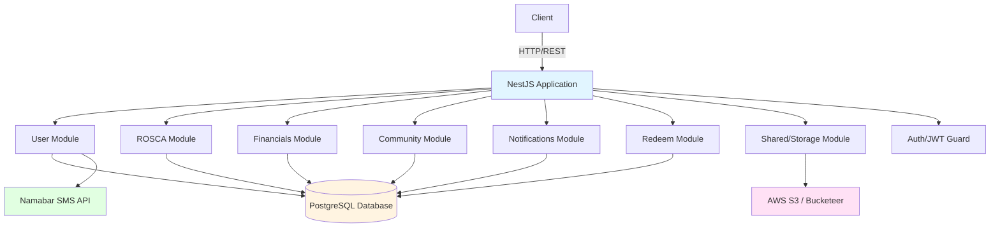
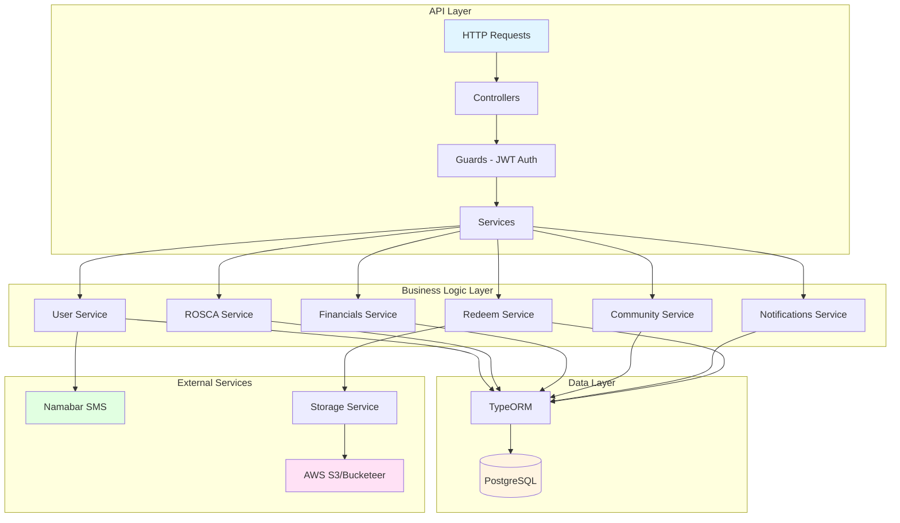
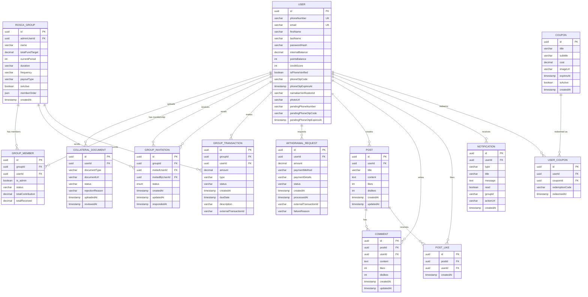
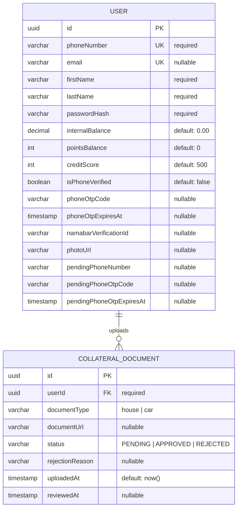
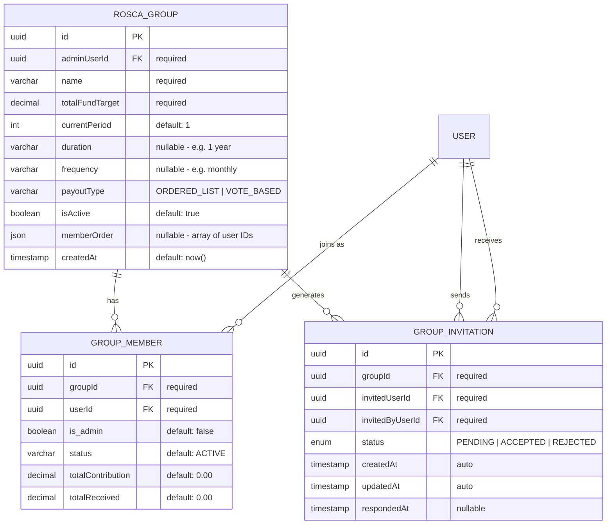
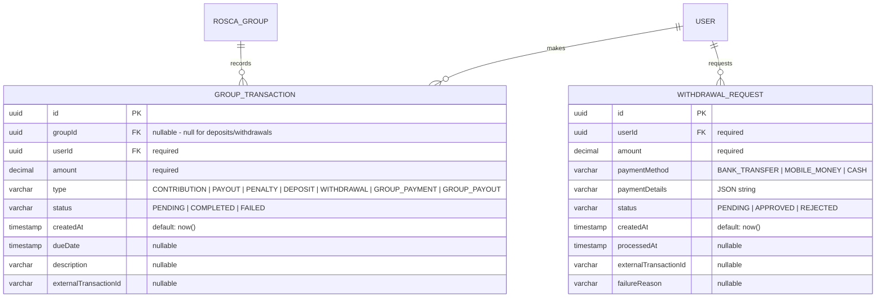
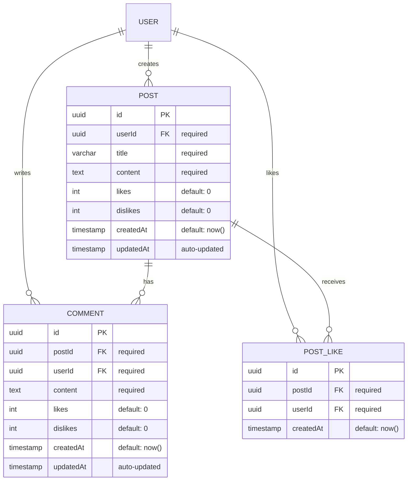
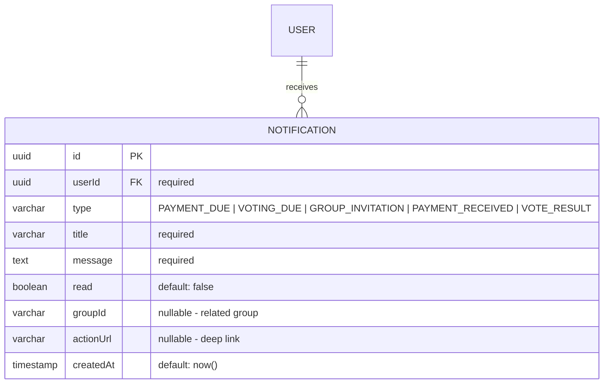
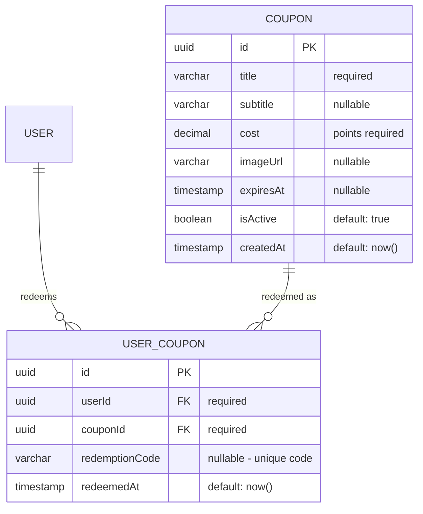

## Risqe Backend (NestJS)

Production-ready NestJS backend implementing User/Auth, ROSCA, Financials, Community, Notifications, and Redeem domains with PostgreSQL + TypeORM.

---

## Table of Contents

- [Architecture Overview](#architecture-overview)
- [System Architecture](#system-architecture)
- [Entity Relationship Diagrams](#entity-relationship-diagrams)
  - [Full ERD (All Entities)](#full-erd-all-entities)
  - [Domain ERDs](#domain-erds)
    - [User & Authentication Domain](#1-user--authentication-domain)
    - [ROSCA Domain](#2-rosca-domain)
    - [Financial Domain](#3-financial-domain)
    - [Community Domain](#4-community-domain)
    - [Notifications Domain](#5-notifications-domain)
    - [Rewards Domain](#6-rewards-domain)
- [Module Structure](#module-structure)
- [Getting Started](#getting-started)
- [API Documentation](#api-documentation)
- [Technology Stack](#technology-stack)

---

## Architecture Overview



---

## System Architecture



---

## Entity Relationship Diagrams

The database schema is organized into **6 domains** with **12 entities** total.

### Full ERD (All Entities)

Complete entity relationship diagram showing all entities with their fields and relationships:



---

### Domain ERDs

Detailed ERDs for each domain with field specifications and constraints.

---

### 1. User & Authentication Domain

Handles user accounts, authentication, and collateral verification.



**Key Features:**

- Phone-based authentication with OTP verification via Namabar SMS
- Internal wallet balance and points system
- Credit score tracking (default: 500)
- Phone number change flow with pending verification
- Collateral documents for credit verification

---

### 2. ROSCA Domain

Manages ROSCA (Rotating Savings and Credit Association) groups, memberships, and invitations.



**Key Features:**

- Two payout types: `ORDERED_LIST` (predetermined order) or `VOTE_BASED` (members vote)
- Member order stored as JSON array for ordered payouts
- Invitation system with accept/reject flow
- Contribution and payout tracking per member

---

### 3. Financial Domain

Handles all financial transactions including contributions, payouts, deposits, and withdrawals.



**Transaction Types:**

| Type            | Description                        |
| --------------- | ---------------------------------- |
| `CONTRIBUTION`  | Member contribution to ROSCA group |
| `PAYOUT`        | Payout received from ROSCA group   |
| `PENALTY`       | Penalty for late/missed payments   |
| `DEPOSIT`       | Deposit to internal wallet         |
| `WITHDRAWAL`    | Withdrawal from internal wallet    |
| `GROUP_PAYMENT` | Payment made to group              |
| `GROUP_PAYOUT`  | Payout distributed from group      |

---

### 4. Community Domain

Powers the social features with posts, comments, and likes.



**Key Features:**

- Posts with title and content
- Nested comments on posts
- Like/dislike system with counter caching
- Unique constraint: one like per user per post

---

### 5. Notifications Domain

Handles user notifications for various events.



**Notification Types:**

| Type               | Description                          |
| ------------------ | ------------------------------------ |
| `PAYMENT_DUE`      | Reminder for upcoming payment        |
| `VOTING_DUE`       | Reminder to vote on payout recipient |
| `GROUP_INVITATION` | Invitation to join a group           |
| `PAYMENT_RECEIVED` | Confirmation of payment received     |
| `VOTE_RESULT`      | Result of voting round               |

---

### 6. Rewards Domain

Manages the coupon/rewards system for point redemption.



**Key Features:**

- Point-based coupon redemption
- Coupon expiration and active status
- Unique redemption codes per user-coupon pair

---

## Module Structure

```
src/
├── app.module.ts                 # Root module
├── main.ts                       # Application entry point
├── config/
│   └── database.config.ts        # Database configuration
├── user/
│   ├── user.entity.ts            # User entity
│   ├── collateral-document.entity.ts
│   ├── user.module.ts
│   ├── dto/
│   │   └── user.dto.ts
│   ├── auth/                     # Authentication
│   │   ├── auth.controller.ts
│   │   ├── auth.service.ts
│   │   ├── jwt.strategy.ts
│   │   ├── jwt-auth.guard.ts
│   │   └── dto/
│   └── phone/                    # Phone verification
│       ├── phone.controller.ts
│       └── phone.service.ts
├── rosca/
│   ├── group.entity.ts
│   ├── group-member.entity.ts
│   ├── group-invitation.entity.ts
│   ├── rosca.module.ts
│   ├── dto/
│   │   └── rosca.dto.ts
│   └── rosca/
│       ├── rosca.controller.ts
│       └── rosca.service.ts
├── financials/
│   ├── group-transaction.entity.ts
│   ├── withdrawal-request.entity.ts
│   ├── financials.module.ts
│   ├── dto/
│   │   └── financials.dto.ts
│   └── financials/
│       ├── financials.controller.ts
│       └── financials.service.ts
├── community/
│   ├── post.entity.ts
│   ├── comment.entity.ts
│   ├── post-like.entity.ts
│   ├── community.module.ts
│   ├── dto/
│   │   └── community.dto.ts
│   └── community/
│       ├── community.controller.ts
│       └── community.service.ts
├── notifications/
│   ├── notification.entity.ts
│   ├── notifications.module.ts
│   └── notifications/
│       ├── notifications.controller.ts
│       └── notifications.service.ts
├── redeem/
│   ├── coupon.entity.ts          # Coupon + UserCoupon entities
│   ├── redeem.module.ts
│   └── redeem/
│       ├── redeem.controller.ts
│       └── redeem.service.ts
├── seeds/
│   └── seed.ts                   # Database seeder
└── shared/
    └── storage/                  # File storage (S3/Bucketeer)
        ├── storage.module.ts
        └── storage.service.ts
```

---

## Getting Started

### 1. Install Dependencies

```bash
npm install
```

### 2. Database Setup (PostgreSQL)

**macOS:**

```bash
brew install postgresql@15
brew services start postgresql@15
createdb risqe_db
```

**Linux:**

```bash
sudo apt-get install postgresql postgresql-contrib
sudo -u postgres createdb risqe_db
```

### 3. Environment Configuration

Create a `.env` file in the root directory:

```env
# Database
DB_HOST=localhost
DB_PORT=5432
DB_USERNAME=postgres
DB_PASSWORD=your_password
DB_DATABASE=risqe_db

# JWT
JWT_SECRET=your_jwt_secret_key_here

# SMS Provider (Namabar)
NAMABAR_API_URL=https://api.namabar.krd
NAMABAR_API_KEY=your_api_key
NAMABAR_SENDER_ID=RISQE

# AWS S3 / Bucketeer (for file storage)
BUCKETEER_BUCKET_NAME=your_bucket_name
BUCKETEER_AWS_REGION=eu-west-1
BUCKETEER_AWS_ACCESS_KEY_ID=your_access_key
BUCKETEER_AWS_SECRET_ACCESS_KEY=your_secret_key

# Or use standard AWS credentials
AWS_S3_BUCKET_NAME=your_bucket_name
AWS_S3_REGION=eu-west-1
AWS_ACCESS_KEY_ID=your_access_key
AWS_SECRET_ACCESS_KEY=your_secret_key

# Server
PORT=3000
```

### 4. Run Development Server

```bash
npm run start:dev
```

The application will be available at:

- **API**: `http://localhost:3000`
- **API Documentation**: `http://localhost:3000/reference` (Scalar)
- **Swagger UI**: `http://localhost:3000/docs` (if configured)

### 5. Seed Database

```bash
npm run seed
```

### 6. Run Tests

```bash
# Unit tests
npm run test

# E2E tests
npm run test:e2e

# Test coverage
npm run test:cov
```

---

## API Documentation

The API documentation is available at `/reference` using Scalar API Reference. All endpoints are documented with:

- Request/response schemas
- Authentication requirements
- Example requests
- Error responses

---

## Key Features

### Authentication & User Management

- **Phone-based authentication** with OTP via Namabar SMS
- **JWT-based authentication** for protected routes
- **User profile management** (name, email, photo)
- **Password reset** via OTP
- **Phone number change** with verification
- **Collateral document upload** for credit verification
- **User search** by email, phone, or name

### ROSCA (Rotating Savings and Credit Association)

- **Group creation** with configurable payout types (ORDERED_LIST, VOTE_BASED)
- **Member management** with admin roles
- **Group invitations** via email
- **Voting system** for payout distribution
- **Transaction tracking** (contributions, payouts)
- **Payment due management** with automatic transaction creation

### Financial Management

- **Internal wallet** with balance tracking
- **Deposit/Withdrawal** requests
- **Transaction history** with filtering
- **Payment processing** for group contributions
- **Points system** for rewards
- **Credit score** tracking

### Community Features

- **Posts** with likes/dislikes
- **Comments** on posts
- **Post interactions** tracking

### Notifications

- **Real-time notifications** for:
  - Payment due reminders
  - Voting deadlines
  - Group invitations
  - Payment received confirmations
  - Vote results
- **Notification filtering** by type
- **Read/unread** status tracking

### Rewards & Redemption

- **Coupon system** with point-based redemption
- **Coupon management** (active/inactive, expiration)
- **Redemption tracking** with unique codes

### File Storage

- **S3/Bucketeer integration** for file uploads
- **Avatar uploads** for user profiles
- **Document storage** for collateral verification
- **Automatic URL generation** for uploaded files

---

## Database Migrations

In development, TypeORM `synchronize` is enabled. For production:

1. Disable `synchronize` in `database.config.ts`
2. Use migrations for schema changes:

```bash
# Generate migration
npm run typeorm migration:generate -- -n MigrationName

# Run migrations
npm run typeorm migration:run

# Revert migration
npm run typeorm migration:revert
```

---

## Authentication

Most endpoints require JWT authentication. Include the token in the Authorization header:

```
Authorization: Bearer <your_jwt_token>
```

---

## File Storage Configuration

The application supports both AWS S3 and Bucketeer for file storage. Configure using environment variables:

- **Bucketeer** (recommended for Heroku): Use `BUCKETEER_*` variables
- **AWS S3**: Use `AWS_*` variables

Files are automatically uploaded and public URLs are generated. Supported file types:

- Images: JPEG, PNG, GIF, WebP
- Documents: PDF, DOC, DOCX

---

## Development Scripts

```bash
# Development
npm run start:dev          # Start with watch mode

# Building
npm run build              # Build for production
npm run start:prod         # Run production build

# Testing
npm run test               # Unit tests
npm run test:watch         # Watch mode
npm run test:cov           # Coverage report
npm run test:e2e           # E2E tests

# Code Quality
npm run lint               # Run ESLint
npm run format             # Format with Prettier

# Database
npm run seed               # Seed database

# Versioning
npm run version:patch      # Bump patch version
npm run version:minor      # Bump minor version
npm run version:major      # Bump major version
```

---

## Production Deployment

1. **Environment Variables**: Ensure all required environment variables are set
2. **Database**: Run migrations before starting the application
3. **Build**: Run `npm run build` to compile TypeScript
4. **Start**: Use `npm run start:prod` or a process manager like PM2

---

## Notes

- **TypeORM Synchronize**: Disabled in production. Use migrations instead.
- **JWT Tokens**: Tokens expire after a configured period. Refresh tokens may be implemented.
- **File Uploads**: Maximum file size limits should be configured at the reverse proxy level (e.g., Nginx).
- **Rate Limiting**: Consider implementing rate limiting for production.
- **CORS**: Configure CORS settings for your frontend domain.

---

## Technology Stack

| Category       | Technology                         |
| -------------- | ---------------------------------- |
| Framework      | NestJS 11.x                        |
| Language       | TypeScript 5.x                     |
| Database       | PostgreSQL (via TypeORM)           |
| Authentication | JWT (Passport)                     |
| File Storage   | AWS S3 / Bucketeer                 |
| SMS            | Namabar API                        |
| API Docs       | Scalar API Reference + Swagger     |
| Validation     | class-validator, class-transformer |

---

## Contributing

1. Follow the TypeScript and NestJS coding guidelines
2. Write tests for new features
3. Update API documentation
4. Follow the commit message conventions

---

## License

This project is private and proprietary.
